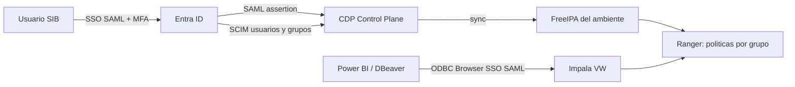
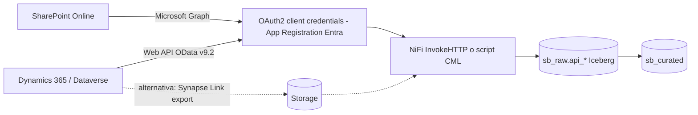
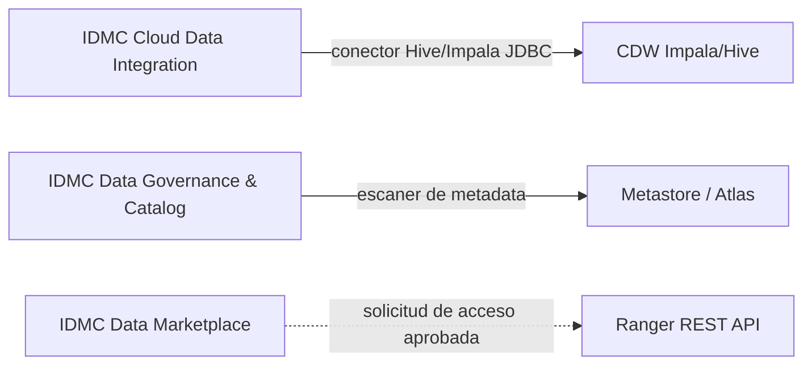
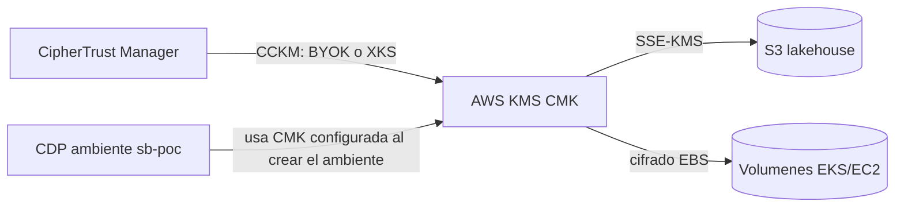

# C03 - Integraciones: APIs de la plataforma y escenarios de conexion

## C03-PRE-02 / AE-01: APIs y endpoints disponibles (prueba en vivo)

| Superficie | Endpoint / herramienta | Prueba en vivo sugerida |
|---|---|---|
| Control plane CDP | CDP CLI / REST (`cdp environments`, `cdp dw`, `cdp de`, `cdp ml`, `cdp datalake`) | `cdp dw list-vws --cluster-id <id>` |
| Jobs de ingenieria | CDE Jobs API `https://<vc>/dex/api/v1` | ver curl abajo |
| Gobierno | Atlas REST v2 via Knox `.../cdp-proxy-api/atlas/api/atlas/v2` | buscar entidad `sb_curated.clientes` |
| Seguridad | Ranger REST via Knox `.../cdp-proxy-api/ranger/service/public/v2/api` | listar politicas `sb_*` |
| SQL | JDBC/ODBC Impala y Hive (HTTP 443, LDAP o Browser SSO SAML) | Power BI, DBeaver |
| ML | CML API v2, endpoints de modelos, AI Inference (compatible OpenAI) | prediccion `curl` |
| Lakehouse abierto | Iceberg REST Catalog | PyIceberg (C01-AE-06) |

Pruebas (Terminal). Reemplazar valores CAMBIAR:
```
curl -u sb_ing01:CAMBIAR "https://CAMBIAR_CDE_SERVICE_HOST/gateway/authtkn/knoxtoken/api/v1/token"
curl -H "Authorization: Bearer CAMBIAR_TOKEN" "https://CAMBIAR_VC_A_HOST/dex/api/v1/jobs"
curl -X POST -H "Authorization: Bearer CAMBIAR_TOKEN" "https://CAMBIAR_VC_A_HOST/dex/api/v1/jobs/sb-pipeline-batch/run"
curl -u sb_admin01:CAMBIAR "https://CAMBIAR_GATEWAY_HOST/CAMBIAR_DATALAKE/cdp-proxy-api/atlas/api/atlas/v2/search/basic?typeName=hive_table&query=sb_curated"
curl -u sb_admin01:CAMBIAR "https://CAMBIAR_GATEWAY_HOST/CAMBIAR_DATALAKE/cdp-proxy-api/ranger/service/public/v2/api/policy?policyNamePartial=sb_"
```

## C03-AE-03: Entra ID (escenario; en la demo el IdP es Keycloak con el mismo patron SAML)


## C03-AE-04 / AE-05: SharePoint y Dynamics 365 (integracion via API)

Demo funcional: `c03_ingesta_api_autenticada.py --fuente sharepoint|dataverse`.

## C03-AE-06: Informatica IDMC (integracion de terceros)

Declarar: la integracion se configura del lado de Informatica (conectores y escaneres de IDMC); Cloudera expone JDBC, HMS y APIs de Atlas/Ranger. Validar version de escaner con Informatica.

## C03-AE-07: Thales CipherTrust Manager (integracion en la capa de llaves de AWS)

Declarar: CDP consume la CMK de AWS KMS; CipherTrust gestiona el ciclo de vida de esa llave. No es una integracion certificada directamente por Cloudera; es una arquitectura de responsabilidad en la capa de nube. Tokenizacion con preservacion de formato requeriria el producto de tokenizacion de Thales o Protegrity (UDFs).
