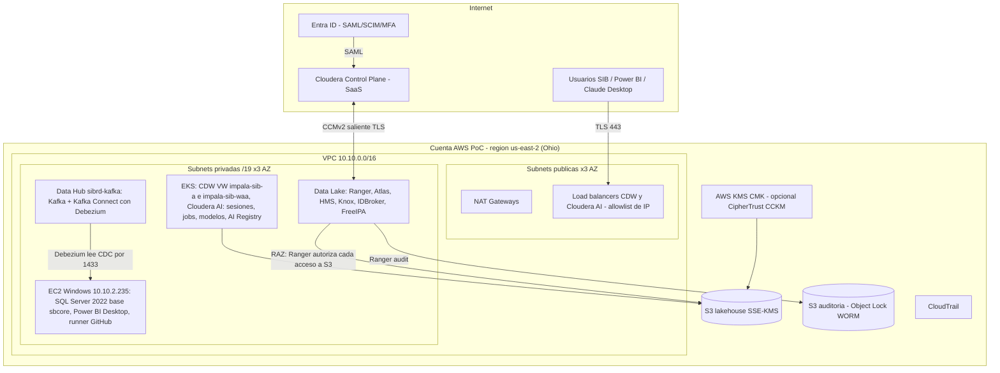

# C07-AE-06: diagrama de red y seguridad del ambiente de demo

Controles a narrar: identidad unica (Entra -> CDP -> FreeIPA -> Ranger), sin credenciales AWS de larga duracion para usuarios
(IDBroker mapea identidad a rol IAM), cifrado en reposo con CMK y en transito con TLS, endpoints publicos restringidos por IP
(o privados con VPN/Direct Connect en produccion), auditoria inmutable, separacion por tenant (VW/VC/workspace).
Produccion objetivo: un ambiente CDP por dev/test/prod, cada uno con su VPC o subnets, Data Lake, rol IAM y buckets.
