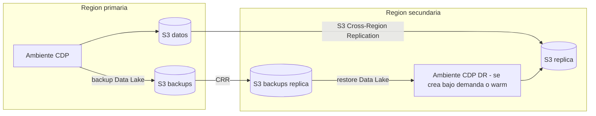

# C09 - Administracion, FinOps y continuidad: runbooks de demo

## C09-PRE-01 / AE-01: costos por proyecto y ambiente (showback)
- Tags definidos al crear el ambiente (Fase 1): `proyecto=sb-poc`, `ambiente=poc`, `centro_costo=CAMBIAR`. CDP los propaga a EC2, EBS, EKS y S3.
- **CDP Management Console > Consumption / Usage**: consumo de creditos por servicio y por Virtual Warehouse / Virtual Cluster / Workspace
  (granularidad real del tenant de la PoC: Data Lake, Data Hubs sibrd-kafka, VW impala-sib-a, workspace de Cloudera AI).
  Filtro de fechas: el periodo de la PoC. Captura: consumo por servicio y por recurso.
- **AWS Cost Explorer**: Group by Tag `proyecto` y `ambiente` (activar los tags como cost allocation tags en Billing, 24 h antes).
  Si la cuenta AWS de demo no da acceso a Billing/Cost Explorer: declarar y mostrar los tags en las instancias EC2 del ambiente.
- Chargeback por usuario/consulta: Cloudera Observability (SKU adicional). Declararlo.

## C09-PRE-02 / AE-02: escenario de pico y control de sobreconsumo
- Pico medido (una sola corrida cubre tambien C02-PRE-06/AE-10): escalones de 50 en 50 hasta 500 usuarios sobre impala-sib-a,
  `python fase3/c02/c02_prueba_carga.py --prueba recursos_fijos --niveles 50,100,150,200,250,300,350,400,450,500 --segundos 60`
  (sesion de CAI de 8 vCPU / 16 GB; ~11 min). Resultado por escalon en sb_consumption.metricas_rendimiento y en el CSV.
- Costo base = nodos minimos x costo/hora; costo pico = nodos maximos observados x duracion (tomar de Grafana CDW + la calculadora).
- Controles: maximo de ejecutores del VW (WAA), auto-suspend del VW, cuotas de CPU/memoria por usuario en Cloudera AI, AWS Budgets con alerta al 80%.

## C09-AE-03: modelo comercial  -> **responsable: AE** (el SE acompana con la calculadora y los supuestos tecnicos)
Componentes: consumo Cloudera (CCU por servicio y hora), infraestructura AWS en la cuenta del cliente (EC2, EBS, S3, red), soporte.

## C09-AE-04: cuello de botella provocado y diagnostico
1. Borrar estadisticas y lanzar una consulta con join grande (Hue, user001, VW impala-sib-a):
```sql
DROP STATS sb_curated.transacciones;
SELECT c.region, COUNT(*) FROM sb_curated.transacciones t
JOIN sb_curated.cuentas cu ON cu.id_cuenta = t.id_cuenta
JOIN sb_curated.clientes c ON c.id_cliente = cu.id_cliente GROUP BY c.region;
```
2. Diagnostico: Hue > Query History > Profile (advertencia "missing statistics", join order, bytes spilled, tiempo por operador);
   CDW > VW > Grafana (memoria y CPU por ejecutor).
3. Ajuste: `COMPUTE STATS sb_curated.transacciones; COMPUTE STATS sb_curated.cuentas; COMPUTE STATS sb_curated.clientes;`
4. Re-ejecutar y comparar tiempo y plan (broadcast vs partitioned join) en el profile.

## C09-AE-05: perdida de un nodo (se explica en sesion, no se ejecuta)
Mensaje, con redaccion precisa para no sobreprometer:
- **Plano de control y servicios con HA**: Data Lake en modo HA (escala Medium Duty / Enterprise); en CDW, coordinador de
  Impala con HA activo-pasivo (y statestore), Trino con coordinador HA y reintento por consulta.
- **Nodos de computo**: corren en EKS sobre grupos de autoescalado; un nodo caido se reemplaza automaticamente.
- **Consulta en curso**: Impala aplica *transparent query retry*: si un ejecutor cae, la consulta se **reintenta
  completa** de forma automatica y el usuario recibe el resultado (con mas latencia). No continua el fragmento perdido.
  Spark (CDE) reintenta las tareas perdidas en otro ejecutor y el job termina.
- Si el evaluador pide verlo: se ofrece como 2DA PARTE (requiere acceso kubeconfig al cluster de CDW).
Evidencia documental: configuracion HA del Data Lake y del VW (consola) + documentacion oficial de query retry.

## C09-AE-06: SLA de incidentes, RTO y RPO (documental)
Presentar: SLA de soporte segun nivel contratado (tiempos de respuesta por severidad) y la documentacion vigente de disponibilidad
del control plane. Aclarar responsabilidad compartida: el plano de datos corre en la cuenta AWS del cliente y su disponibilidad
depende de la arquitectura (multi-AZ) y de AWS. RTO/RPO de la plataforma = los del runbook de DR siguiente.

## C09-AE-07: DR ante caida de region del proveedor de nube

Comandos (Terminal, CDP CLI):
```
cdp datalake backup-datalake --datalake-name CAMBIAR_DATALAKE --backup-location s3a://CAMBIAR_BUCKET_BACKUP/dl-backups/
cdp datalake backup-datalake-status --datalake-name CAMBIAR_DATALAKE
cdp datalake restore-datalake --datalake-name CAMBIAR_DATALAKE_DR --backup-id CAMBIAR_BACKUP_ID
```
Declarar: no hay activo-activo multi-region administrado. RPO = frecuencia de backup + retraso de replicacion S3 (minutos a horas);
RTO = horas (crear ambiente y servicios con IaC/CLI + restore). Trafico: DNS (Route 53) apuntando a los endpoints del ambiente DR.
